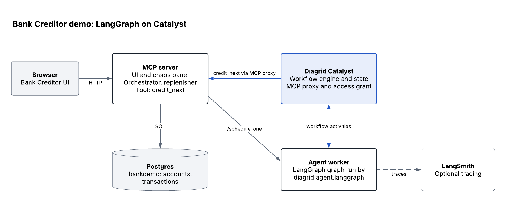

# Bank Creditor Demo

A durability demo for LangGraph agents on Diagrid Catalyst. Ten agents, one per customer account, credit their account from $100 to $200 in $1 steps while you kill pods, take out an availability zone, slow down or break the MCP server. Every account still finishes at exactly $200, with 1,000 transactions and none lost.

The same demo runs in three variants, each in its own namespace with its own UI:

| Variant | Code | Survives a pod kill? |
|---|---|---|
| LangGraph on Catalyst | `services/agent-langgraph` | Yes |
| Plain LangGraph, no Catalyst | `services/agent-plain` | No: the killed pod's accounts stop for good |
| Dapr Agents on Catalyst | `services/agent-dapr-agents` | Yes |

Both LangGraph variants can send traces to LangSmith, so the difference also shows up there ([Deployment](docs/DEPLOYMENT.md) step 7).

## Architecture



[Edit in Lucid](https://lucid.app/lucidchart/74555cb5-7a45-4dfe-9b2b-3df8d51d2b88/edit)

Clicking **Start run** in the UI makes the MCP server's replenisher call the agent's `/schedule-one` once per account. Each call starts a durable workflow on Catalyst. Every graph step runs as a Catalyst activity, and the agent's one tool, `credit_next`, reaches the MCP server through Catalyst's MCP proxy. When a pod dies, Catalyst hands the unfinished activity to a surviving pod. Every deployment path therefore needs a Catalyst project (Self-Hosted or Cloud).

## Documentation

- **[Deployment](docs/DEPLOYMENT.md)**: deploy to any Kubernetes cluster, or run locally against Catalyst
  - [Catalyst Self-Hosted](docs/CATALYST_SELF_HOSTED.md): the Catalyst control plane inside your own cluster
  - [Catalyst local dev](docs/CATALYST.md): `diagrid dev run` on your laptop
- **[Demo run guide](docs/DEMO_FLOW.md)**: what to click during the demo and what you should see
- **[Troubleshooting](docs/TROUBLESHOOTING.md)**: common failures across all deploy paths
- **[Local Dapr](docs/LOCAL_DAPR.md)**: a debugging recipe for testing Dapr Workflow durability without Catalyst. Not a deployment path.

## Databases

| DB | Purpose |
|---|---|
| `bankdemo` | App data: `customers`, `accounts`, `execution_runs`, `transactions`, `audit_log` |
| `dapr_state` | Dapr workflow state for deploys that don't use Catalyst's managed state store. The MCP server can't see it. |

Credits are exactly-once because `transactions` has a composite `(execution_run_id, tx_id)` primary key: a retried credit hits the key and is ignored. Every insert fires `pg_notify('tx_committed', ...)`. The MCP server listens on that channel and pushes each transaction to the UI over WebSocket, which is why balances tick up $1 at a time.

## Images

The charts pull from public ECR, tagged by semver (currently `0.2.0`):

- `public.ecr.aws/d3f9w4q8/bank-creditor-demo/agent`
- `public.ecr.aws/d3f9w4q8/bank-creditor-demo/agent-plain`
- `public.ecr.aws/d3f9w4q8/bank-creditor-demo/mcp`

[Deployment](docs/DEPLOYMENT.md) covers building and pushing new versions.

## Repo layout

```
.
├── ui-prototype/             # React UI, loaded via babel-standalone, served by the MCP server
├── services/
│   ├── mcp/                  # FastAPI + MCP SDK: tools, orchestrator, replenisher, chaos, WebSocket
│   ├── agent-langgraph/      # LangGraph agent on Catalyst (diagrid.agent.langgraph)
│   ├── agent-plain/          # The same LangGraph agent with no Catalyst
│   └── agent-dapr-agents/    # The same agent built with Dapr Agents
├── deploy/
│   ├── postgres/             # Helm chart: Postgres, schema and seed
│   ├── mcp/                  # Helm chart: MCP server (also serves the UI)
│   ├── agent/                # Helm chart: agent worker on Catalyst (LangGraph or Dapr Agents)
│   ├── agent-plain/          # Helm chart: plain LangGraph agent
│   ├── ingress/              # Helm chart: nginx Ingress
│   └── catalyst-selfhosted/  # Values override for the Catalyst Self-Hosted gateway ports
├── local/
│   ├── compose.yaml          # docker compose: Postgres + MCP server (the agent runs on your laptop)
│   └── init.sql              # bankdemo schema + dapr_state DB
├── scripts/
│   └── switch-llm-mode.sh    # Stub/real LLM switch; the current agents only support stub
└── docs/
    ├── architecture.png      # The diagram above, exported from Lucid
    ├── DEPLOYMENT.md
    ├── CATALYST.md
    ├── CATALYST_SELF_HOSTED.md
    ├── DEMO_FLOW.md
    ├── TROUBLESHOOTING.md
    └── LOCAL_DAPR.md
```
